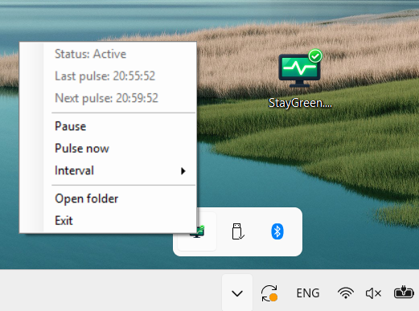
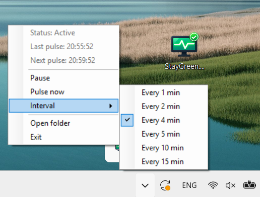
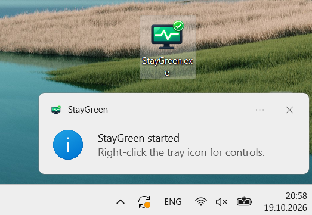
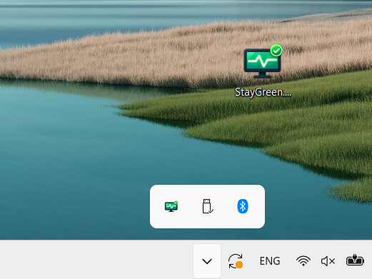

# StayGreen

**StayGreen** is a lightweight, portable Windows system-tray utility that sends periodic **Ctrl + Shift** keyboard pulses and requests that Windows keep the system and display awake while the app is active.

It runs quietly in the notification area, with quick controls for pulse timing, pausing, and sending an immediate pulse. No installer, administrator rights, or external services are required.

> **Windows only (v1.1).** StayGreen is an independent utility and is not affiliated with any messaging or collaboration platform.

## Highlights

- **Portable:** Run `StayGreen.exe` directly; no installation required.
- **Standard user friendly:** Does not require administrator privileges for normal use.
- **Messaging compatibility:** Successfully tested with popular workplace messaging and collaboration applications; active/available presence was observed during testing.
- **Used in real environments:** Tested in daily use for more than six months on multiple Windows computers.
- **Antivirus experience:** No Microsoft Defender alerts or interference were observed during that testing.
- **Adjustable frequency:** Choose 1, 2, 4, 5, 10, or 15 minutes.
- **Tray controls:** Pause/resume, pulse now, interval selection, open folder, and exit.
- **Local-only:** The supplied source code contains no telemetry or network communication.

**Compatibility note:** These are real-world testing observations, not a guarantee across every computer, security policy, or messaging application. Downloaded unsigned executables may still receive Windows reputation warnings; antivirus decisions and presence indicators can vary by environment.

## Screenshots

| System tray menu | Interval settings |
|---|---|
|  |  |

| Startup notification | Running in the tray |
|---|---|
|  |  |

## Download and start

1. Open the **Releases** page of this GitHub repository.
2. Download the Windows asset `StayGreen.exe` from the latest release.
3. Put it in any folder you prefer (for example, `Documents\StayGreen`).
4. Double-click `StayGreen.exe`. No installation or administrative elevation is necessary in a normal Windows user environment.
5. When the notification appears, locate the StayGreen icon in the **system tray**. It may be under the small **Show hidden icons** arrow.
6. **Right-click** the icon to open the controls.

> Requires Windows with the **.NET Framework 4.x** components used by the app. Windows policies or endpoint security software may restrict execution in managed environments.

## User manual

### System tray controls

| Menu item | What it does |
|---|---|
| **Status: Active / Paused** | Shows the current operating state. |
| **Last pulse** | Local time of the most recent pulse; shows `not yet` until the first pulse. |
| **Next pulse** | Local time of the next scheduled pulse; shows `-` when paused. |
| **Pause / Resume** | Stops or restarts automatic pulses and toggles the app's sleep-prevention request. The tray icon changes when paused. |
| **Pulse now** | Sends one Ctrl + Shift pulse immediately, even if automatic pulses are paused. |
| **Interval** | Changes the automatic pulse interval (1, 2, 4, 5, 10, or 15 minutes). The selected interval is checked. |
| **Open folder** | Opens the directory containing the executable. |
| **Exit** | Closes StayGreen and clears the application's sleep-prevention request. |

### Typical use

1. Launch the executable. The app starts **Active**.
2. Open the tray menu and choose **Interval**. The default is **Every 4 min**.
3. Leave StayGreen running in the system tray.
4. Choose **Pause** when automatic pulses are not needed; choose **Resume** to restart them.
5. Choose **Exit** to close the app entirely.

StayGreen sends its first scheduled pulse approximately **2 seconds** after launch or resume. Each pulse presses Ctrl and Shift for approximately **60 milliseconds**, then releases both keys. A manual pulse resets the next automatic pulse time.

**Double-click shortcut:** Double-clicking the tray icon sends an immediate pulse when active, or resumes the app when paused.

**Settings:** The interval is kept in memory for the current session. It returns to the 4-minute default when the application is restarted. StayGreen does not install a service or configure Windows startup automatically.

### What StayGreen does — and does not do

When active, the app sends synthetic Ctrl + Shift key events and calls the Windows power-management API to request that the display and system remain awake. It does **not** connect to or control messaging services through their APIs, read messages, or collect user data.

Presence detection varies among applications and organizations, so active status is not guaranteed everywhere. Simulated keyboard activity may be unsuitable for certain workplace policies. Use the utility where permitted.

## Build from source

The source is written in **C# with Windows Forms**, with a PowerShell build script using the Windows .NET Framework C# compiler included with compatible Windows installations.

Open **Windows PowerShell** in the repository directory and run:

```powershell
powershell.exe -NoProfile -ExecutionPolicy Bypass -File .\Build-StayGreen.ps1
```

The script generates `StayGreen.ico` from `Icon.png`, then compiles `StayGreen.cs` into `StayGreen.exe` with the application icon embedded. No NuGet packages or additional third-party dependencies are required.

The included `StayGreen.exe` release asset is a convenience binary; the source files are provided so you can review and build the application yourself.

## Troubleshooting

- **No tray icon?** Check **Show hidden icons** in the notification area. The program does not open a main window.
- **Program doesn't launch?** Confirm that your Windows environment allows the executable and has the required .NET Framework components.
- **Application already running?** StayGreen limits itself to one instance for the current user session.
- **Presence still becomes idle?** Presence is controlled by the respective application and organizational settings. Keyboard pulses cannot guarantee a particular status.
- **Need normal sleep behavior?** Use **Pause** or **Exit**. Note that **Pulse now**, even while paused, temporarily invokes the awake request in the current version; to restore the paused sleep state afterward, select **Resume** followed by **Pause**.
- **Keyboard shortcut conflict?** Ctrl + Shift may be assigned by Windows or another app. Pause/exit StayGreen if the combination interferes with your work.

## Release history

See [RELEASE_NOTES.md](RELEASE_NOTES.md) for v1.1 release notes.

## License

StayGreen is released under the [MIT License](LICENSE). Copyright (c) 2026 Mark Urupa.
